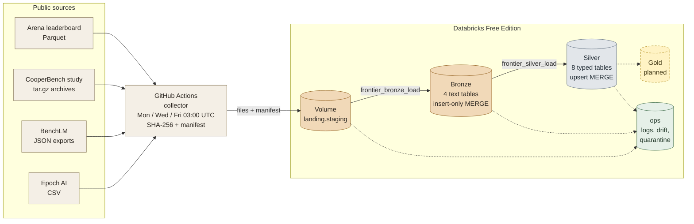

<div align="center">

# Frontier AI Observatory

**An automated, auditable Medallion lakehouse for published AI model evaluations, releases and pricing.**

<p>


</p>
<p>


</p>

[Overview](#overview) &nbsp;|&nbsp; [Architecture](#architecture) &nbsp;|&nbsp; [Data sources](#data-sources) &nbsp;|&nbsp; [Quick start](#quick-start) &nbsp;|&nbsp; [Execution guide](#execution-guide) &nbsp;|&nbsp; [Bronze models](#bronze-data-models) &nbsp;|&nbsp; [Silver models](#silver-data-models) &nbsp;|&nbsp; [Audit and logging](#audit-and-logging) &nbsp;|&nbsp; [Proof](#proof)

</div>

---

## Overview

Choosing an AI model means reading evidence that comes from different places, in different units, with different methods. A high score may describe one task only. A low token price says little about an agent's reliability or how long it runs. The Observatory collects that evidence in one place and keeps every number tied to its source and its measurement context.

It brings four public sources into a lakehouse with **Apache Spark** on **Databricks Free Edition**, processes them through **Bronze** (raw text) and **Silver** (typed, validated, de-duplicated) layers, and is built so that a Gold layer and a dashboard can sit on top. The project analyses existing public evidence only. It needs no paid inference, no GPU and no benchmark execution.

> [!NOTE]
> **Status.** Collection, the Bronze layer and the Silver layer are implemented and have run on the full historical load. The `gold` schema exists and is empty. Gold and the dashboard are described in the [roadmap](#roadmap).

### At a glance

| | |
|---|---|
| **Sources** | 4 (Arena leaderboard, CooperBench study, BenchLM, Epoch AI) |
| **Bronze tables** | 4, every source column stored as text |
| **Silver tables** | 8, typed and validated, one row per business key |
| **Operational tables** | 5 (execution, error, quarantine, drift, Silver quarantine) |
| **Collection schedule** | Monday, Wednesday and Friday at 03:00 UTC |
| **First full load** | about 192 MB landed, 2,200,800 Arena rows, 17,328 CooperBench files, 2,383 BenchLM records, 3,626 Epoch models |
| **Full Silver pass** | about 4 minutes on serverless compute |
| **Cost** | Free tiers only (Databricks Free Edition, GitHub Actions) |

---

## Architecture



| Layer | Schema | What it holds |
|---|---|---|
| Landing | `landing` | A Unity Catalog volume with the original files, one manifest per batch, collector state and logs |
| Bronze | `bronze` | One Delta table per source. Every source column is `STRING`, plus provenance and the whole source record as JSON |
| Silver | `silver` | Typed, validated, de-duplicated tables. One row per business key, updated by `MERGE INTO` |
| Gold | `gold` | Created and empty. Reserved for the analytical model |
| Operations | `ops` | Execution log, error log, file quarantine, schema drift log, Silver quarantine |

### Design principles

- **Original evidence stays untouched.** Landed files are kept in `processed/`, so Bronze can be rebuilt batch by batch without downloading anything again.
- **Bronze never rejects on type.** It stores text. Meaning is decided in Silver, where each decision is logged.
- **Contracts are explicit.** No `inferSchema` and no `mergeSchema` anywhere. Schemas are built in code before a file is read.
- **Everything can be repeated.** Every write is a `MERGE INTO`. The same input twice changes nothing.
- **Nothing fails silently.** One bad file, record or table is logged and set aside, and the rest of the batch still loads.

---

## Data sources

| Source | What it provides | Format | Cadence | Licence |
|---|---|---|---|---|
| [**Arena leaderboard**](https://huggingface.co/datasets/lmarena-ai/leaderboard-dataset) | Rating histories for text, style-controlled text, web development and agent evaluations | Parquet | Irregular | CC BY 4.0 |
| [**CooperBench**](https://huggingface.co/datasets/CooperBench/team-trajectories) | A study of coding-agent coordination in four settings: solo, shared Git, full team, team without protocol verbs | tar.gz of JSON | Historical, corrections only | Apache 2.0 |
| [**BenchLM**](https://benchlm.ai/data) | Models, benchmark definitions and API pricing | JSON (3 exports) | 1 to 3 times a week | CC BY-NC 4.0 |
| [**Epoch AI**](https://epoch.ai/data/ai-models) | Model release and training metadata | CSV | Daily | Attribution requested |

The schedule follows how often the sources change. Epoch updates daily, BenchLM one to three times a week, Arena and CooperBench irregularly, so three runs a week catch Epoch quickly without wasting compute.

---

## Repository layout

```text
.
├── .github/
│   └── workflows/
│       └── frontier-collect.yml          GitHub Actions: smoke, full and incremental collection
├── docs/
│   ├── Frontier_Bronze_Run_Guide.md      Step-by-step guide for Raw to Bronze, with the Databricks setup
│   └── Frontier_Silver_Run_Guide.md      Silver decisions, status and plan updates
├── ingestion/
│   └── frontier_collect.py               Collector: source to volume, manifest, state
├── notebooks/
│   └── 00_setup_databricks.ipynb         One-time setup: five schemas, the volume and its folders
├── proof/                                Executed Silver notebooks with their saved outputs (see Proof)
├── proposals/                            Project proposal documents
├── sample_data/
│   ├── full/                             Full-load samples: arena, benchlm, cooperbench
│   ├── incremental/                      Incremental samples: the latest Arena files
│   ├── manifest.json                     Source revision, size and SHA-256 of every sample
│   └── README.md
├── spark/
│   ├── bronze/
│   │   └── frontier_bronze_load.ipynb    Raw files to Bronze (parameterised, backfill, replay)
│   └── silver/
│       └── frontier_silver_load.ipynb    Bronze to Silver (parameterised, backfill, replay, quarantine)
├── .gitignore
├── LICENSE
├── README.md
└── requirements.txt
```

---

## Engineering guarantees

| Guarantee | How it works | Where |
|---|---|---|
| **Explicit schemas** | Each source is read against a `StructType` built in code. Silver uses column maps that name every source column or JSON path and its type | `ARENA_CONTRACT`, `EPOCH_CONTRACT`, `COOP_ROW_SCHEMA`, `BLM_ROW_SCHEMA`, Silver column maps |
| **Strict typing** | Bronze is text. Silver casts with `try_cast`, so a bad value becomes null and never stops a batch | Silver Cell 5 |
| **`load_timestamp` everywhere** | Every Bronze, Silver and `ops` table has it. In Silver it changes only when a row is inserted or updated | all tables |
| **Idempotency** | Bronze: insert-only `MERGE` on `record_hash`, plus a file-level skip for an already loaded SHA-256. Silver: upsert `MERGE` that updates only when the content hash changed in a newer batch | `merge_insert_only()`, `merge_upsert()` |
| **Parameterised backfill** | No hard-coded dates or paths. Widgets select batches, ranges, sources and folders. Batches run oldest first | [Execution guide](#execution-guide) |
| **Schema drift** | New columns are added as text and logged. Type changes cannot break Bronze and become logged nulls or quarantined records in Silver | [Schema drift](#schema-drift-and-quarantine) |
| **Key integrity** | After any load that changed rows, a key check counts duplicate and null keys in every table and fails the run on a problem | `check_primary_keys()`, `key_check()` |
| **Full audit trail** | One log row for every file, table, batch and run with layer, parameter, start, end, status and row counts | [Audit and logging](#audit-and-logging) |

---

## Quick start

> [!IMPORTANT]
> Everything runs on free tiers. You need a Databricks Free Edition workspace and a GitHub repository with Actions enabled.

1. **Create the workspace objects.** In Databricks, import this repository as a **Git folder**, then run `notebooks/00_setup_databricks` once. It creates the schemas `landing`, `bronze`, `silver`, `gold` and `ops`, the volume `/Volumes/<catalog>/landing/staging/frontier` and its folders. Every statement uses `IF NOT EXISTS`, so running it again is harmless.
2. **Give GitHub access to Databricks.** Add the repository secrets `DATABRICKS_HOST` and `DATABRICKS_TOKEN`. `HF_TOKEN` is optional.
3. **Collect once.** In GitHub, open *Actions*, choose *Frontier data collector*, and run it with `smoke` first, then `full` once.
4. **Load Bronze.** Run `spark/bronze/frontier_bronze_load` with no parameters.
5. **Load Silver.** Run `spark/silver/frontier_silver_load` with no parameters.
6. **Automate.** Create a Databricks Job with two notebook tasks, `raw_to_bronze` and then `bronze_to_silver` (depends on the first), and set **Maximum concurrent runs** to 1 so two loads never write at the same time.

Size rules are checked in the collector and again in the Bronze notebook. A `full` load must land at least 150 MB and an `incremental` batch at least 1 MB. A batch that breaks the rule is refused and logged.

---

## Execution guide

The same two notebooks handle both a standard load and a backfill. Only the parameters differ. Nothing in the code changes.

| | Standard incremental load | Backfill |
|---|---|---|
| **When** | Every Monday, Wednesday and Friday | A period needs to be loaded again, or a fix must be applied to history |
| **Collect** | Automatic at 03:00 UTC, or *Run workflow* with `incremental` | Not needed. Files are already in `processed/` |
| **Bronze parameters** | None | `source_dir=processed` with a batch or date selector and `force_reload=true` |
| **Silver parameters** | None | A batch or date selector with `force_reload=true` |
| **What is processed** | Only batches not yet logged as loaded | Exactly the batches selected, oldest first, one at a time |
| **Safe to repeat** | Yes | Yes. `MERGE INTO` never creates duplicates |

### Standard incremental load

1. **Collect.** Automatic every Monday, Wednesday and Friday at 03:00 UTC, or open *Actions*, choose *Frontier data collector*, *Run workflow*, and pick `incremental`.
2. **Bronze.** Run `spark/bronze/frontier_bronze_load` with **no parameters**. It picks up every manifest in `new/`, loads it, and moves the loaded files to `processed/`.
3. **Silver.** Run `spark/silver/frontier_silver_load` with **no parameters**. It processes every Bronze batch that has no `SUCCESS` log row for Silver yet.

A Databricks Job runs steps 2 and 3 for you.

### Parameters

Both notebooks use the same widget names.

| Widget | Notebook | Meaning |
|---|---|---|
| `catalog`, `bronze_schema`, `silver_schema` | both | Where the tables live. Defaults `workspace`, `bronze`, `silver`. Use another schema name to test safely |
| `source` | both | Bronze: `all`, `arena`, `cooperbench`, `benchlm`, `epoch`. Silver: the same values (`benchlm` and `cooperbench` each cover three Silver tables) |
| `load_type` | Bronze | `all`, `full` or `incremental` |
| `source_dir` | Bronze | `new` (default), `processed`, or any `/Volumes/...` folder that has its own `_manifests` |
| `batch_id` | both | One batch |
| `from_batch`, `to_batch` | both | A range of batch ids or id prefixes, both ends included |
| `start_date`, `end_date` | both | A range of collection days, `YYYY-MM-DD` |
| `force_reload` | both | Process again what was already loaded. Safe because of the `MERGE` |
| `replay` | both | Every batch from the first, oldest first, one at a time. Always runs with `force_reload` |

Batch ids look like `20261005T030000Z_incremental`. `from_batch` and `to_batch` accept a full id or only the timestamp prefix, such as `20261005`.

### Backfill recipes

For Bronze, add `source_dir=processed` and `force_reload=true` to every row. For Silver, add `force_reload=true`.

| Goal | Parameters |
|---|---|
| From batch X to batch Y | `from_batch=20261001`, `to_batch=20261008T030000Z` |
| Everything from batch X onward | `from_batch=20261005T030000Z` |
| Everything up to batch Y | `to_batch=20261005T030000Z` |
| One batch | `batch_id=<batch id>` |
| A date range (day the batch was collected) | `start_date=2026-09-01`, `end_date=2026-09-30` |
| Only one source | `source=arena` |
| Only incremental batches of one month (Bronze) | `load_type=incremental`, `start_date=2026-10-01`, `end_date=2026-10-31` |
| Another folder of files (Bronze) | `source_dir=/Volumes/<catalog>/landing/staging/frontier/<folder>` |

When `source_dir` is not `new`, Bronze does not move files. With `force_reload=false`, a file whose SHA-256 was already loaded successfully is skipped.

### Replay from the start

Use `replay=true` when a layer was emptied or damaged, or when you want to watch the data build up again.

- **Bronze:** reads `processed/`, takes every batch in the order it arrived, and loads each one separately. The first batch is the original full load and the later ones are the incremental batches. Nothing is downloaded again.
- **Silver:** reads the Bronze tables batch by batch in the same order. After a `TRUNCATE TABLE` of a Silver table it rebuilds it completely.
- Add `from_batch` and `to_batch` to replay only part of the history. Afterwards, run the notebook once normally to pick up anything still waiting.

### Checking a run

```sql
-- latest runs, all layers
SELECT layer, file_or_param, status, rows_read, rows_inserted, rows_updated,
       rows_skipped_duplicate, rows_quarantined, start_time, end_time
FROM   workspace.ops.pipeline_execution_logs
ORDER  BY load_timestamp DESC LIMIT 30;

-- what Silver set aside, and why
SELECT silver_table, reason, column_name, COUNT(*) AS records
FROM   workspace.ops.silver_quarantine_log
GROUP  BY 1, 2, 3 ORDER BY 1, 4 DESC;

-- schema events
SELECT detected_at, dataset, column_name, event_type, action_taken
FROM   workspace.ops.schema_drift_log ORDER BY detected_at DESC LIMIT 40;
```

A repeated run with the same input shows `rows_inserted = 0` and `rows_updated = 0` for every table. That is the idempotency check.

---

## Bronze data models

Bronze is **schema on read**. Every source column is stored as `STRING`. Only `collection_timestamp` and `load_timestamp` are timestamps. A type change in a source can therefore never reject a file. Each row keeps its provenance and, for three of the four tables, the whole source record as JSON.

The primary key of every Bronze table is `record_hash`. Delta does not enforce keys, so the pipeline does: an insert-only `MERGE INTO` on the key, de-duplication inside each chunk, and a key check after every load.

<details>
<summary><b>bronze.arena_leaderboard_raw &nbsp;·&nbsp; PK: <code>record_hash</code> &nbsp;·&nbsp; 26 columns</b></summary>

*One row of an Arena Parquet file.*

| Column | Type | Notes |
|---|---|---|
| `subset` | STRING | Dataset name from the manifest: text, text_style_control, webdev or agent |
| `load_type` | STRING | full or incremental |
| `model_name` | STRING | Contract column |
| `organization` | STRING | Contract column |
| `license` | STRING | Contract column |
| `rating` | STRING | Contract column, stored as text |
| `variance` | STRING | Contract column |
| `rating_q975` | STRING | Contract column |
| `rating_q025` | STRING | Contract column |
| `vote_count` | STRING | Contract column |
| `rank` | STRING | Contract column |
| `category` | STRING | Contract column |
| `leaderboard_publish_date` | STRING | Contract column |
| `rating_lower` | STRING | Added automatically when the web development subset arrived (NEW_COLUMN) |
| `rating_upper` | STRING | Added automatically (NEW_COLUMN) |
| `score` | STRING | Added automatically when the agent subset arrived (NEW_COLUMN) |
| `score_ci_lower` | STRING | Added automatically (NEW_COLUMN) |
| `score_ci_upper` | STRING | Added automatically (NEW_COLUMN) |
| `observation_count` | STRING | Added automatically (NEW_COLUMN) |
| `session_count` | STRING | Added automatically (NEW_COLUMN) |
| `raw_payload` | STRING | The whole source row as JSON, keys sorted |
| `record_hash` | STRING | Primary key. SHA-256 of subset and raw_payload |
| `source_file` | STRING | Path of the landed Parquet file |
| `batch_id` | STRING | Collector batch that carried the file |
| `collection_timestamp` | TIMESTAMP | When the collector fetched the source |
| `load_timestamp` | TIMESTAMP | When this row was written to Bronze |

</details>

<details>
<summary><b>bronze.cooperbench_member_raw &nbsp;·&nbsp; PK: <code>record_hash</code> &nbsp;·&nbsp; 11 columns</b></summary>

*One JSON or JSONL file from a CooperBench archive.*

| Column | Type | Notes |
|---|---|---|
| `study_setting` | STRING | solo, coopgit, team or team_noproto |
| `archive_file` | STRING | Name of the compressed archive |
| `member_path` | STRING | Path of the file inside the archive |
| `member_extension` | STRING | .json or .jsonl |
| `member_size_bytes` | STRING | Size of the member, as text |
| `raw_content` | STRING | The file content, unchanged |
| `record_hash` | STRING | Primary key. SHA-256 of setting, member path and content hash |
| `source_file` | STRING | Path of the landed archive |
| `batch_id` | STRING | Collector batch |
| `collection_timestamp` | TIMESTAMP | When the collector fetched the source |
| `load_timestamp` | TIMESTAMP | When this row was written to Bronze |

</details>

<details>
<summary><b>bronze.benchlm_raw &nbsp;·&nbsp; PK: <code>record_hash</code> &nbsp;·&nbsp; 12 columns</b></summary>

*One record of a BenchLM export.*

| Column | Type | Notes |
|---|---|---|
| `dataset` | STRING | models, benchmarks or pricing |
| `record_path` | STRING | Where the records sit inside the JSON file |
| `record_key` | STRING | Key of the record when the file is a map |
| `record_index` | STRING | Position of the record in the file |
| `raw_payload` | STRING | The record as canonical JSON |
| `payload_hash` | STRING | SHA-256 of raw_payload |
| `record_hash` | STRING | Primary key. SHA-256 of snapshot, dataset and record position |
| `snapshot_id` | STRING | SHA-256 of the landed file |
| `source_file` | STRING | Path of the landed file |
| `batch_id` | STRING | Collector batch |
| `collection_timestamp` | TIMESTAMP | When the collector fetched the source |
| `load_timestamp` | TIMESTAMP | When this row was written to Bronze |

</details>

<details>
<summary><b>bronze.epoch_models_raw &nbsp;·&nbsp; PK: <code>record_hash</code> &nbsp;·&nbsp; 65 columns</b></summary>

*One row of an Epoch CSV snapshot. The 57 source columns are listed separately.*

| Column | Type | Notes |
|---|---|---|
| `raw_payload` | STRING | The whole source row as JSON, keys sorted |
| `payload_hash` | STRING | SHA-256 of raw_payload |
| `record_hash` | STRING | Primary key. SHA-256 of snapshot_id and raw_payload |
| `snapshot_id` | STRING | SHA-256 of the landed CSV file |
| `source_file` | STRING | Path of the landed file |
| `batch_id` | STRING | Collector batch |
| `collection_timestamp` | TIMESTAMP | When the collector fetched the source |
| `load_timestamp` | TIMESTAMP | When this row was written to Bronze |

The 57 source columns, all `STRING`, named exactly as the CSV publishes them (the first ten are the contract, the other 47 were added automatically):

`Model` · `Domain` · `Task` · `Organization` · `Authors` · `Publication date` · `Reference` · `Link` · `Citations` · `Notability criteria` · `Notability criteria notes` · `Parameters` · `Parameters notes` · `Training compute (FLOP)` · `Training compute notes` · `Training dataset size (total)` · `Dataset size notes` · `Training time (hours)` · `Training time notes` · `Training hardware` · `Approach` · `Confidence` · `Abstract` · `Epochs` · `WikiText and Penn Treebank data` · `Model accessibility` · `Country (of organization)` · `Base model` · `Finetune compute (FLOP)` · `Finetune compute notes` · `Hardware quantity` · `Hardware utilization (MFU)` · `Last modified` · `Training cloud compute vendor` · `Training data center` · `Archived links` · `Batch size` · `Batch size notes` · `Organization categorization` · `Foundation model` · `Training compute lower bound` · `Training compute upper bound` · `Training chip-hours` · `Training code accessibility` · `Accessibility notes` · `Possibly over 1e23 FLOP` · `Training compute cost (2023 USD)` · `Utilization notes` · `Numerical format` · `Frontier model` · `Training power draw (W)` · `Training compute estimation method` · `Hugging Face developer id` · `Post-training compute (FLOP)` · `Post-training compute notes` · `Hardware utilization (HFU)` · `Open model weights?`

</details>

---

## Silver data models

Silver tables are typed, validated and current. Each has **one row per business key**, written by `MERGE INTO`. Every table carries lineage columns (`bronze_record_hash`, `bronze_batch_id`, `source_file`, `collection_timestamp`) and `load_timestamp`, which holds the moment the row was inserted or last updated.

| Table | Primary key | Rows after the first load | Set aside |
|---|---|---|---|
| `silver.arena_leaderboard` | `subset`, `category`, `model_name`, `leaderboard_publish_date` | 2,200,576 | 224 |
| `silver.epoch_models` | `model`, `publication_date` | 3,614 | 12 |
| `silver.benchlm_models` | `slug` | 889 | 0 |
| `silver.benchlm_benchmarks` | `benchmark_key`, `category` | 667 | 0 |
| `silver.benchlm_pricing` | `canonical_model_key` | 827 | 0 |
| `silver.cooperbench_members` | `study_setting`, `member_path` | 17,327 | 1 |
| `silver.cooperbench_evals` | `study_setting`, `member_path` | 2,584 | 0 |
| `silver.cooperbench_runs` | `study_setting`, `member_path` | 2,606 | 0 |

<details>
<summary><b>silver.arena_leaderboard &nbsp;·&nbsp; PK: <code>subset, category, model_name, leaderboard_publish_date</code> &nbsp;·&nbsp; 20 columns</b></summary>

*One model rating in one subset and category on one publication date.*

| Column | Type | Source and rule |
|---|---|---|
| `subset` | STRING | Bronze `subset`. **Key.** One of `text`, `text_style_control`, `webdev`, `agent`, otherwise quarantined |
| `category` | STRING | Bronze `category`. **Key.** Missing: quarantined |
| `model_name` | STRING | Bronze `model_name`, cleaned. **Key.** Missing: quarantined |
| `model_key` | STRING | Join key for Gold: lower-case `model`/`model_name`, runs of non-alphanumeric characters replaced by `-`, leading and trailing `-` removed |
| `organization` | STRING | Bronze `organization`, cleaned |
| `license` | STRING | Bronze `license`, cleaned |
| `leaderboard_publish_date` | DATE | `yyyy-MM-dd` text cast to DATE. **Key.** Must be between 2023-01-01 and tomorrow, otherwise quarantined |
| `rating` | DOUBLE | `coalesce(rating, score)` (`agent` publishes `score`). Missing: quarantined. Must be above 0, except in `agent` where scores can be negative |
| `rating_variance` | DOUBLE | Bronze `variance`. Negative: set to null, logged |
| `rating_ci_lower` | DOUBLE | `coalesce(rating_q025, rating_lower, score_ci_lower)`. If lower > rating, upper < rating or lower > upper, both bounds are set to null |
| `rating_ci_upper` | DOUBLE | `coalesce(rating_q975, rating_upper, score_ci_upper)`. Same check as the lower bound |
| `vote_count` | BIGINT | Whole-number cast. Negative: null, logged |
| `observation_count` | BIGINT | Whole-number cast (`'29.0'` becomes 29). Negative: null, logged |
| `session_count` | BIGINT | Whole-number cast. Negative: null, logged |
| `rank` | BIGINT | Whole-number cast. Below 1: null, logged |
| `bronze_record_hash` | STRING | Bronze primary key of the source row (lineage) |
| `bronze_batch_id` | STRING | Bronze `batch_id` (lineage) |
| `source_file` | STRING | Bronze `source_file` (lineage) |
| `collection_timestamp` | TIMESTAMP | Bronze `collection_timestamp`: when the collector fetched the source (lineage; decides which version is newer) |
| `load_timestamp` | TIMESTAMP | When this Silver row was inserted or last updated (`current_timestamp()`) |

</details>

<details>
<summary><b>silver.epoch_models &nbsp;·&nbsp; PK: <code>model, publication_date</code> &nbsp;·&nbsp; 41 columns</b></summary>

*The latest version of one model in Epoch's database.*

| Column | Type | Source and rule |
|---|---|---|
| `model` | STRING | Bronze `Model`. **Key.** Missing: quarantined |
| `model_key` | STRING | Join key for Gold: lower-case `model`/`model_name`, runs of non-alphanumeric characters replaced by `-`, leading and trailing `-` removed |
| `domain` | STRING | Bronze `Domain` |
| `task` | STRING | Bronze `Task` |
| `organization` | STRING | Bronze `Organization` |
| `authors` | STRING | Bronze `Authors` |
| `publication_date` | DATE | Bronze `Publication date` as a date. **Key.** Missing, invalid or after tomorrow: quarantined (12 rows today) |
| `reference` | STRING | Bronze `Reference` |
| `link` | STRING | Bronze `Link`. Not starting with `http`: null, logged |
| `citations` | BIGINT | Bronze `Citations` as a whole number. Negative: null, logged |
| `notability_criteria` | STRING | Bronze `Notability criteria` |
| `notability_criteria_notes` | STRING | Bronze `Notability criteria notes` |
| `parameters` | DOUBLE | Bronze `Parameters` as a number. Negative: null, logged |
| `training_compute_flop` | DOUBLE | Bronze `Training compute (FLOP)` as a number. Negative: null, logged |
| `training_dataset_size_total` | DOUBLE | Bronze `Training dataset size (total)` as a number. Negative: null, logged |
| `training_time_hours` | DOUBLE | Bronze `Training time (hours)` as a number. Negative: null, logged |
| `training_hardware` | STRING | Bronze `Training hardware` |
| `approach` | STRING | Bronze `Approach` |
| `confidence` | STRING | Bronze `Confidence` |
| `epochs` | DOUBLE | Bronze `Epochs` as a number. Negative: null, logged |
| `model_accessibility` | STRING | Bronze `Model accessibility` |
| `country_of_organization` | STRING | Bronze `Country (of organization)` |
| `base_model` | STRING | Bronze `Base model` |
| `finetune_compute_flop` | DOUBLE | Bronze `Finetune compute (FLOP)` as a number. Negative: null, logged |
| `hardware_quantity` | DOUBLE | Bronze `Hardware quantity` as a number. Negative: null, logged |
| `hardware_utilization_mfu` | DOUBLE | Bronze `Hardware utilization (MFU)` as a number |
| `last_modified` | TIMESTAMP | Bronze `Last modified` as a timestamp |
| `organization_categorization` | STRING | Bronze `Organization categorization` |
| `foundation_model` | STRING | Bronze `Foundation model` |
| `frontier_model` | STRING | Bronze `Frontier model` |
| `training_compute_cost_usd_2023` | DOUBLE | Bronze `Training compute cost (2023 USD)` as a number. Negative: null, logged |
| `training_power_draw_w` | DOUBLE | Bronze `Training power draw (W)` as a number. Negative: null, logged |
| `open_model_weights` | BOOLEAN | Bronze `Open model weights?`: `Yes`/`No` as a boolean |
| `hugging_face_developer_id` | STRING | Bronze `Hugging Face developer id` |
| `snapshot_id` | STRING | Bronze `snapshot_id` (lineage) |
| `payload_hash` | STRING | Bronze `payload_hash`. The MERGE updates a row only when this value changes |
| `bronze_record_hash` | STRING | Bronze primary key of the source row (lineage) |
| `bronze_batch_id` | STRING | Bronze `batch_id` (lineage) |
| `source_file` | STRING | Bronze `source_file` (lineage) |
| `collection_timestamp` | TIMESTAMP | Bronze `collection_timestamp`: when the collector fetched the source (lineage; decides which version is newer) |
| `load_timestamp` | TIMESTAMP | When this Silver row was inserted or last updated (`current_timestamp()`) |

</details>

<details>
<summary><b>silver.benchlm_models &nbsp;·&nbsp; PK: <code>slug</code> &nbsp;·&nbsp; 35 columns</b></summary>

*One model in BenchLM's ranking.*

| Column | Type | Source and rule |
|---|---|---|
| `slug` | STRING | `slug`. **Key.** Missing: quarantined |
| `id` | STRING | `id` |
| `model` | STRING | `model` |
| `model_key` | STRING | Join key for Gold: lower-case `model`/`model_name`, runs of non-alphanumeric characters replaced by `-`, leading and trailing `-` removed |
| `canonical_model_key` | STRING | `canonicalModelKey` |
| `creator` | STRING | `creator` |
| `family` | STRING | `family` |
| `release_date` | DATE | `releaseDate` as a date (`yyyy-MM-dd`) |
| `reasoning_type` | STRING | `reasoningType` |
| `evidence_status` | STRING | `evidenceStatus` |
| `ranking_eligible` | BOOLEAN | `rankingEligible` as a boolean (`true`/`false`, also `yes`/`no`) |
| `market` | STRING | `market` |
| `is_regional` | BOOLEAN | `isRegional` as a boolean (`true`/`false`, also `yes`/`no`) |
| `source_type` | STRING | `sourceType` |
| `ordering_meaning` | STRING | `orderingMeaning` |
| `public_ranking_mode` | STRING | `publicRankingMode` |
| `overall_rank` | BIGINT | `overallRank` as a number |
| `display_score` | DOUBLE | `displayScore` as a number |
| `provisional_display_score` | DOUBLE | `provisionalDisplayScore` as a number |
| `context_window` | STRING | `contextWindow` |
| `context_window_tokens` | BIGINT | `contextWindowTokens` as a number. Negative: null, logged |
| `ranking_json` | STRING | nested value `ranking` kept as JSON text |
| `coverage_json` | STRING | nested value `coverage` kept as JSON text |
| `score_interval90_json` | STRING | nested value `scoreInterval90` kept as JSON text |
| `scores_json` | STRING | nested value `scores` kept as JSON text |
| `benchmarks_json` | STRING | nested value `benchmarks` kept as JSON text |
| `url` | STRING | `url` |
| `markdown_url` | STRING | `markdownUrl` |
| `snapshot_id` | STRING | Bronze `snapshot_id` (lineage) |
| `payload_hash` | STRING | Bronze `payload_hash`. The MERGE updates a row only when this value changes |
| `bronze_record_hash` | STRING | Bronze primary key of the source row (lineage) |
| `bronze_batch_id` | STRING | Bronze `batch_id` (lineage) |
| `source_file` | STRING | Bronze `source_file` (lineage) |
| `collection_timestamp` | TIMESTAMP | Bronze `collection_timestamp`: when the collector fetched the source (lineage; decides which version is newer) |
| `load_timestamp` | TIMESTAMP | When this Silver row was inserted or last updated (`current_timestamp()`) |

</details>

<details>
<summary><b>silver.benchlm_benchmarks &nbsp;·&nbsp; PK: <code>benchmark_key, category</code> &nbsp;·&nbsp; 33 columns</b></summary>

*One benchmark in one category.*

| Column | Type | Source and rule |
|---|---|---|
| `benchmark_key` | STRING | `benchmarkKey`. **Key** (with `category`) |
| `category` | STRING | `category`. **Key** (with `benchmark_key`). The same benchmark can sit in two categories |
| `name` | STRING | `name` |
| `full_name` | STRING | `fullName` |
| `capability_category` | STRING | `capabilityCategory` |
| `category_label` | STRING | `categoryLabel` |
| `scored_category` | STRING | `scoredCategory` |
| `scoring_basis` | STRING | `scoringBasis` |
| `weight` | DOUBLE | `weight` as a number. Negative: null, logged |
| `decimals` | BIGINT | `decimals` as a number. Negative: null, logged |
| `year` | BIGINT | `year` as a number |
| `difficulty` | STRING | `difficulty` |
| `format` | STRING | `format` |
| `tasks` | STRING | `tasks` |
| `description` | STRING | `description` |
| `authors` | STRING | `authors` |
| `paper_title` | STRING | `paperTitle` |
| `paper_url` | STRING | `paperUrl` |
| `url` | STRING | `url` |
| `markdown_url` | STRING | `markdownUrl` |
| `successor_key` | STRING | `successorKey` |
| `successor_url` | STRING | `successorUrl` |
| `displayable_score_count` | BIGINT | `displayableScoreCount` as a number. Negative: null, logged |
| `evaluated_configuration_count` | BIGINT | `evaluatedConfigurationCount` as a number |
| `source_result_note` | STRING | `sourceResultNote` |
| `source_result_tables` | STRING | nested value `sourceResultTables` kept as JSON text |
| `snapshot_id` | STRING | Bronze `snapshot_id` (lineage) |
| `payload_hash` | STRING | Bronze `payload_hash`. The MERGE updates a row only when this value changes |
| `bronze_record_hash` | STRING | Bronze primary key of the source row (lineage) |
| `bronze_batch_id` | STRING | Bronze `batch_id` (lineage) |
| `source_file` | STRING | Bronze `source_file` (lineage) |
| `collection_timestamp` | TIMESTAMP | Bronze `collection_timestamp`: when the collector fetched the source (lineage; decides which version is newer) |
| `load_timestamp` | TIMESTAMP | When this Silver row was inserted or last updated (`current_timestamp()`) |

</details>

<details>
<summary><b>silver.benchlm_pricing &nbsp;·&nbsp; PK: <code>canonical_model_key</code> &nbsp;·&nbsp; 27 columns</b></summary>

*One model's price record.*

| Column | Type | Source and rule |
|---|---|---|
| `canonical_model_key` | STRING | `canonicalModelKey`. **Key.** (`slug` is empty for some models) |
| `slug` | STRING | `slug` |
| `model` | STRING | `model` |
| `model_key` | STRING | Join key for Gold: lower-case `model`/`model_name`, runs of non-alphanumeric characters replaced by `-`, leading and trailing `-` removed |
| `creator` | STRING | `creator` |
| `source_type` | STRING | `sourceType` |
| `context_window` | STRING | `contextWindow` |
| `context_window_tokens` | BIGINT | `contextWindowTokens` as a number. Negative: null, logged |
| `input_price` | DOUBLE | `inputPrice` as a number. Negative: null, logged |
| `output_price` | DOUBLE | `outputPrice` as a number. Negative: null, logged |
| `cached_input_price` | DOUBLE | `cachedInputPrice` as a number. Negative: null, logged |
| `training_price` | DOUBLE | `trainingPrice` as a number. Negative: null, logged |
| `score_per_output_dollar` | DOUBLE | `scorePerOutputDollar` as a number |
| `display_score` | DOUBLE | `displayScore` as a number |
| `overall_rank` | BIGINT | `overallRank` as a number |
| `has_numeric_pricing` | BOOLEAN | `hasNumericPricing` as a boolean (`true`/`false`, also `yes`/`no`) |
| `is_free_pricing` | BOOLEAN | `isFreePricing` as a boolean (`true`/`false`, also `yes`/`no`) |
| `note` | STRING | `note` |
| `url` | STRING | `url` |
| `markdown_url` | STRING | `markdownUrl` |
| `snapshot_id` | STRING | Bronze `snapshot_id` (lineage) |
| `payload_hash` | STRING | Bronze `payload_hash`. The MERGE updates a row only when this value changes |
| `bronze_record_hash` | STRING | Bronze primary key of the source row (lineage) |
| `bronze_batch_id` | STRING | Bronze `batch_id` (lineage) |
| `source_file` | STRING | Bronze `source_file` (lineage) |
| `collection_timestamp` | TIMESTAMP | Bronze `collection_timestamp`: when the collector fetched the source (lineage; decides which version is newer) |
| `load_timestamp` | TIMESTAMP | When this Silver row was inserted or last updated (`current_timestamp()`) |

</details>

<details>
<summary><b>silver.cooperbench_members &nbsp;·&nbsp; PK: <code>study_setting, member_path</code> &nbsp;·&nbsp; 17 columns</b></summary>

*One file inside a CooperBench archive: metadata and validity.*

| Column | Type | Source and rule |
|---|---|---|
| `study_setting` | STRING | Bronze `study_setting`. **Key.** One of `solo`, `coopgit`, `team`, `team_noproto`, otherwise quarantined |
| `member_path` | STRING | Bronze `member_path`. **Key.** Missing: quarantined |
| `member_extension` | STRING | Bronze `member_extension` (`.json`, `.jsonl`) |
| `member_size_bytes` | BIGINT | Whole-number cast. 0 or less: null, logged |
| `file_name` | STRING | Last part of the path |
| `file_type` | STRING | File name without extension; `agent1_traj.json` becomes `agent_traj`, `agent2_sent.jsonl` becomes `agent_sent` |
| `repo` | STRING | Path part `<repo>_task` (null for files above the task level, such as `summary.json`) |
| `task_id` | BIGINT | Path part with the task number |
| `feature_pair` | STRING | Feature pair taken from the path (`f3_f7`) |
| `is_valid_json` | BOOLEAN | JSON parses (every non-empty line for `.jsonl`). Not valid: quarantined |
| `line_count` | BIGINT | Number of non-empty lines, `.jsonl` only |
| `content_hash` | STRING | SHA-256 of `raw_content`. The MERGE updates a row only when this value changes |
| `bronze_record_hash` | STRING | Bronze primary key of the source row (lineage) |
| `bronze_batch_id` | STRING | Bronze `batch_id` (lineage) |
| `source_file` | STRING | Bronze `source_file` (lineage) |
| `collection_timestamp` | TIMESTAMP | Bronze `collection_timestamp`: when the collector fetched the source (lineage; decides which version is newer) |
| `load_timestamp` | TIMESTAMP | When this Silver row was inserted or last updated (`current_timestamp()`) |

</details>

<details>
<summary><b>silver.cooperbench_evals &nbsp;·&nbsp; PK: <code>study_setting, member_path</code> &nbsp;·&nbsp; 30 columns</b></summary>

*One evaluated task run, taken from eval.json.*

| Column | Type | Source and rule |
|---|---|---|
| `repo` | STRING | `repo` |
| `task_id` | BIGINT | `task_id` as a number |
| `features` | STRING | nested value `features` kept as JSON text |
| `setting_label` | STRING | `setting` |
| `both_passed` | BOOLEAN | `both_passed` as a boolean (`true`/`false`, also `yes`/`no`) |
| `error` | STRING | `error` |
| `evaluated_at` | TIMESTAMP | `evaluated_at` as a timestamp |
| `apply_status_agent1` | STRING | `apply_status.agent1` |
| `apply_status_agent2` | STRING | `apply_status.agent2` |
| `merge_status` | STRING | `merge.status` |
| `merge_strategy` | STRING | `merge.strategy` |
| `feature1_passed` | BOOLEAN | `feature1.passed` as a boolean (`true`/`false`, also `yes`/`no`) |
| `feature1_feature_id` | BIGINT | `feature1.feature_id` as a number |
| `feature1_tests_passed` | BIGINT | `feature1.tests_passed` as a number. Negative: null, logged |
| `feature1_tests_failed` | BIGINT | `feature1.tests_failed` as a number. Negative: null, logged |
| `feature1_exit_code` | BIGINT | `feature1.exit_code` as a number |
| `feature2_passed` | BOOLEAN | `feature2.passed` as a boolean (`true`/`false`, also `yes`/`no`) |
| `feature2_feature_id` | BIGINT | `feature2.feature_id` as a number |
| `feature2_tests_passed` | BIGINT | `feature2.tests_passed` as a number. Negative: null, logged |
| `feature2_tests_failed` | BIGINT | `feature2.tests_failed` as a number. Negative: null, logged |
| `feature2_exit_code` | BIGINT | `feature2.exit_code` as a number |
| `study_setting` | STRING | Bronze `study_setting`. **Key** (with `member_path`) |
| `member_path` | STRING | Bronze `member_path`. **Key** (with `study_setting`) |
| `feature_pair` | STRING | Feature pair taken from the path (`f3_f7`) |
| `content_hash` | STRING | SHA-256 of `raw_content`. The MERGE updates a row only when this value changes |
| `bronze_record_hash` | STRING | Bronze primary key of the source row (lineage) |
| `bronze_batch_id` | STRING | Bronze `batch_id` (lineage) |
| `source_file` | STRING | Bronze `source_file` (lineage) |
| `collection_timestamp` | TIMESTAMP | Bronze `collection_timestamp`: when the collector fetched the source (lineage; decides which version is newer) |
| `load_timestamp` | TIMESTAMP | When this Silver row was inserted or last updated (`current_timestamp()`) |

</details>

<details>
<summary><b>silver.cooperbench_runs &nbsp;·&nbsp; PK: <code>study_setting, member_path</code> &nbsp;·&nbsp; 27 columns</b></summary>

*One task run with duration and cost, taken from result.json.*

| Column | Type | Source and rule |
|---|---|---|
| `repo` | STRING | `repo` |
| `task_id` | BIGINT | `task_id` as a number |
| `features` | STRING | nested value `features` kept as JSON text |
| `setting_label` | STRING | `setting` |
| `run_id` | STRING | `run_id` |
| `run_name` | STRING | `run_name` |
| `agent_framework` | STRING | `agent_framework` |
| `model` | STRING | `model` |
| `started_at` | TIMESTAMP | `started_at` as a timestamp |
| `ended_at` | TIMESTAMP | `ended_at` as a timestamp |
| `duration_seconds` | DOUBLE | `duration_seconds` as a number. Negative: null, logged |
| `lead_agent` | STRING | `lead_agent` |
| `total_cost` | DOUBLE | `total_cost` as a number. Negative: null, logged |
| `total_steps` | BIGINT | `total_steps` as a number. Negative: null, logged |
| `messages_sent` | BIGINT | `messages_sent` as a number. Negative: null, logged |
| `log_dir` | STRING | `log_dir` |
| `agents_json` | STRING | nested value `agents` kept as JSON text |
| `metrics_json` | STRING | nested value `metrics` kept as JSON text |
| `study_setting` | STRING | Bronze `study_setting`. **Key** (with `member_path`) |
| `member_path` | STRING | Bronze `member_path`. **Key** (with `study_setting`) |
| `feature_pair` | STRING | Feature pair taken from the path (`f3_f7`) |
| `content_hash` | STRING | SHA-256 of `raw_content`. The MERGE updates a row only when this value changes |
| `bronze_record_hash` | STRING | Bronze primary key of the source row (lineage) |
| `bronze_batch_id` | STRING | Bronze `batch_id` (lineage) |
| `source_file` | STRING | Bronze `source_file` (lineage) |
| `collection_timestamp` | TIMESTAMP | Bronze `collection_timestamp`: when the collector fetched the source (lineage; decides which version is newer) |
| `load_timestamp` | TIMESTAMP | When this Silver row was inserted or last updated (`current_timestamp()`) |

</details>

### Cleaning, casting and validation

Silver reads one Bronze table and one batch at a time, oldest first.

1. **Clean text.** Trim, collapse repeated spaces, turn empty text and the markers `NaN`, `null`, `None`, `N/A`, `n/a` and `-` into null.
2. **Cast with `try_cast`.** A bad value becomes null and never stops the batch.

   | Type | Rule |
   |---|---|
   | `DOUBLE` | `try_cast`; NaN and infinity become null. Values such as `3.55e+24` work |
   | `BIGINT` | accepted only when the value is a whole number (`29.0` becomes 29, `29.5` fails) |
   | `DATE` | `yyyy-MM-dd` only |
   | `TIMESTAMP` | ISO text with or without an offset (`2026-10-05 13:44:28+00:00`) |
   | `BOOLEAN` | `true`, `false`, `yes`, `no` |

3. **Validate.** A failure on a **key or required** field sends the record to quarantine. A failure on an **optional** field sets that field to null, counts it in the log and goes on.

   | Table | Required (record quarantined) | Optional (field set to null) |
   |---|---|---|
   | Arena | `subset` is one of the four; `category`, `model_name` present; publish date valid and between 2023-01-01 and tomorrow; `rating` present and above 0 (the `agent` subset may be negative) | CI bounds consistent with `rating` (both nulled together); counts at least 0; `rank` at least 1; variance at least 0 |
   | Epoch | `model` present; `publication_date` valid and not later than tomorrow | numeric fields at least 0; `link` starts with `http` |
   | BenchLM | payload is valid JSON; key fields present | context size, prices, weight, counts at least 0 |
   | CooperBench members | `study_setting` is one of the four; `member_path` present; content is valid JSON (each non-empty line for `.jsonl`) | `member_size_bytes` above 0 |
   | CooperBench evals and runs | content is valid JSON; `study_setting` and `member_path` present | test counts, duration, cost, steps and messages at least 0 |

4. **De-duplicate.** Rows that share a key in one batch are resolved before the merge. The newest wins (`collection_timestamp`, then for Arena the higher `vote_count`). The others are **not dropped silently**: they go to quarantine as `DUPLICATE_BUSINESS_KEY`.
5. **Upsert.**

   ```sql
   MERGE INTO silver.<table> AS t USING <validated batch> AS s
     ON <key columns equal>
   WHEN MATCHED AND s.collection_timestamp >= t.collection_timestamp
                AND NOT (t.<change column> <=> s.<change column>)
     THEN UPDATE SET <all non-key columns>
   WHEN NOT MATCHED
     THEN INSERT (<all columns>) VALUES (<all columns>)
   ```

   The change column is a content hash (`bronze_record_hash` for Arena, `payload_hash` for Epoch and BenchLM, `content_hash` for CooperBench). A row is updated only when its content changed, and only by a batch that is not older than the row it replaces, so a backfill can never overwrite newer data.
6. **Key check.** After any load that changed rows, and after every backfill or replay, duplicate and null keys are counted per table. A problem fails the run.

---

## Audit and logging

Five tables in the `ops` schema record what the pipeline does.

<details>
<summary><b>ops.pipeline_execution_logs &nbsp;·&nbsp; 20 columns</b></summary>

*One row per file, table, batch and run.*

| Column | Type | Notes |
|---|---|---|
| `run_id` | STRING | One notebook run |
| `batch_id` | STRING | Collector batch, or a range for a backfill |
| `layer` | STRING | Raw-to-Bronze, Bronze-to-Silver and the other layer labels |
| `source` | STRING | arena, cooperbench, benchlm, epoch or all |
| `dataset` | STRING | Subset, archive or table |
| `load_type` | STRING | full, incremental or check |
| `file_or_param` | STRING | The file or parameter that was processed |
| `parameters_json` | STRING | All widget values of the run |
| `start_time` | TIMESTAMP | Execution start |
| `end_time` | TIMESTAMP | Execution end |
| `duration_seconds` | DOUBLE | End minus start |
| `status` | STRING | SUCCESS, FAILURE, SKIPPED, QUARANTINED or REJECTED |
| `rows_read` | BIGINT | Rows read from the input |
| `rows_inserted` | BIGINT | Rows inserted by the MERGE |
| `rows_updated` | BIGINT | Rows updated by the MERGE |
| `rows_skipped_duplicate` | BIGINT | Rows that already existed unchanged |
| `rows_quarantined` | BIGINT | Rows or files set aside |
| `bytes_processed` | BIGINT | Size of the file |
| `message` | STRING | Counts of cast failures, nulls and quarantine reasons |
| `load_timestamp` | TIMESTAMP | When the log row was written |

</details>

<details>
<summary><b>ops.error_logs &nbsp;·&nbsp; 16 columns</b></summary>

*One row per error or warning.*

| Column | Type | Notes |
|---|---|---|
| `error_id` | STRING | Unique id |
| `run_id` | STRING | Id of the notebook or collector run |
| `batch_id` | STRING | Collector batch |
| `component` | STRING | collector, bronze_notebook or silver_notebook |
| `layer` | STRING | Layer label of the step |
| `source` | STRING | Source name |
| `file_or_param` | STRING | The file or parameter processed |
| `severity` | STRING | ERROR or WARNING |
| `error_type` | STRING | Exception class |
| `error_message` | STRING | Message of the exception |
| `http_status` | BIGINT | For download errors |
| `attempt` | BIGINT | Retry number |
| `stack_trace` | STRING | Python stack trace |
| `occurred_at` | TIMESTAMP | When the error happened |
| `resolved` | BOOLEAN | Set to true once the cause is fixed |
| `load_timestamp` | TIMESTAMP | When the log row was written |

</details>

<details>
<summary><b>ops.quarantine_log &nbsp;·&nbsp; 13 columns</b></summary>

*One row per file set aside before Bronze.*

| Column | Type | Notes |
|---|---|---|
| `quarantine_id` | STRING | Unique id |
| `run_id` | STRING | Id of the notebook or collector run |
| `batch_id` | STRING | Collector batch |
| `source` | STRING | Source name |
| `dataset` | STRING | Subset, archive or table |
| `source_file` | STRING | Path of the landed file |
| `item` | STRING | The file or archive member |
| `reason` | STRING | For example SCHEMA_CONTRACT |
| `detail` | STRING | Why the item was set aside |
| `size_bytes` | BIGINT | Size of the file in bytes |
| `record_sample` | STRING | A short sample for diagnosis |
| `quarantined_at` | TIMESTAMP | When the item was set aside |
| `load_timestamp` | TIMESTAMP | When the log row was written |

</details>

<details>
<summary><b>ops.schema_drift_log &nbsp;·&nbsp; 12 columns</b></summary>

*One row per schema event.*

| Column | Type | Notes |
|---|---|---|
| `drift_id` | STRING | Unique id |
| `run_id` | STRING | Id of the notebook or collector run |
| `batch_id` | STRING | Collector batch |
| `dataset` | STRING | For Silver, `silver/<table>` |
| `source_file` | STRING | Path of the landed file |
| `column_name` | STRING | Column concerned |
| `event_type` | STRING | BASELINE, NEW_COLUMN, MISSING_COLUMN, COMPLEX_TYPE, NEW_COLUMN_NOT_PROMOTED or CAST_FAILURE |
| `expected_type` | STRING | Type the pipeline expected |
| `actual_type` | STRING | Type found in the source |
| `action_taken` | STRING | For example TABLE_EVOLVED, FILLED_WITH_NULL, SET_NULL |
| `detected_at` | TIMESTAMP | When the event was detected |
| `load_timestamp` | TIMESTAMP | When the log row was written |

</details>

<details>
<summary><b>ops.silver_quarantine_log &nbsp;·&nbsp; 11 columns</b></summary>

*One row per record and reason set aside by Silver.*

| Column | Type | Notes |
|---|---|---|
| `quarantine_id` | STRING | Primary key. Hash of table, record, column and reason, so a repeat run adds nothing |
| `run_id` | STRING | Id of the notebook or collector run |
| `batch_id` | STRING | Collector batch |
| `silver_table` | STRING | Silver table the record was meant for |
| `bronze_record_hash` | STRING | Points back to the Bronze row |
| `column_name` | STRING | The field that failed |
| `bad_value` | STRING | The original value |
| `reason` | STRING | For example RATING_MISSING_OR_NOT_POSITIVE, DUPLICATE_BUSINESS_KEY |
| `raw_payload` | STRING | The source record, up to 4,000 characters |
| `quarantined_at` | TIMESTAMP | When the item was set aside |
| `load_timestamp` | TIMESTAMP | When the log row was written |

</details>

`pipeline_execution_logs` holds the audit metrics for every file, table, batch and run:

| Audit metric | Column |
|---|---|
| Layer | `layer` |
| Parameter or file processed | `file_or_param`, and `parameters_json` with every widget value of the run |
| Execution start and end | `start_time`, `end_time`, `duration_seconds` |
| Status | `status`: `SUCCESS`, `FAILURE`, `SKIPPED` (same file already loaded), `QUARANTINED` (file set aside, batch continued), `REJECTED` (batch broke the volume rule) |
| Rows inserted and updated | `rows_inserted`, `rows_updated`, plus `rows_read`, `rows_skipped_duplicate`, `rows_quarantined`, `bytes_processed` |

| `layer` value | Written for |
|---|---|
| `Source-to-Landing` | each collector run (sent from GitHub to Databricks) |
| `Raw-to-Bronze` | each file, for full and incremental loads alike |
| `Raw-to-Bronze (batch)`, `(run)` | each batch and each notebook run, including empty or failed ones |
| `Bronze data quality (primary key)` | each Bronze table after a load that changed rows |
| `Bronze-to-Silver` | each Bronze table and batch |
| `Bronze-to-Silver (batch)`, `(run)` | each batch and each run |
| `Silver data quality (primary key)` | each Silver table |

`rows_updated` is always 0 in Bronze, which is insert-only evidence. Updates happen in Silver. A failing file or table is logged with its stack trace and does not stop the others. The run row is then marked `FAILURE` and the notebook raises an error, so a scheduled job shows as failed, and the next run retries only what is still pending.

---

## Schema drift and quarantine

| Event | Bronze | Silver |
|---|---|---|
| A source adds a column | `ALTER TABLE ... ADD COLUMNS` as `STRING`, logged `NEW_COLUMN` | Not carried. Logged `NEW_COLUMN_NOT_PROMOTED` until one line is added to the column map. Then the table is altered and the change logged |
| A source drops a column | Filled with null, logged `MISSING_COLUMN` | The same, for the columns Silver reads |
| A type changes (integer to text, and so on) | Cannot fail, everything is text | `try_cast` gives null and a `CAST_FAILURE` entry with the row count. A required field sends the record to quarantine |
| A value is nested | Stored as JSON text, logged `COMPLEX_TYPE` | Kept as JSON text in a `*_json` column |
| A file cannot be read, a core column is missing, or the CSV header repeats a name | The file moves to `quarantine/` and is logged in `ops.quarantine_log`. The batch continues | Not applicable |
| A record breaks a rule | Not applicable | The record goes to `ops.silver_quarantine_log` and the rest of the batch loads |

Schema changes use `ALTER TABLE ADD COLUMNS` rather than the `mergeSchema` option, so every change is an explicit, logged statement instead of a side effect of a write. Quarantine rows are written by an insert-only `MERGE` on a deterministic id, so a repeated run never adds the same record twice. When a rule is corrected and a record now loads, it is released from the quarantine log automatically.

### Data quirks the pipeline already handles

- **Arena adds columns by subset.** The web development subset adds `rating_lower` and `rating_upper`. The agent subset adds `score` and its bounds. Bronze evolves automatically, and Silver maps all of them onto `rating` and the CI columns.
- **Arena agent scores are negative by design.** The rating rule is "above 0" everywhere except the `agent` subset.
- **One Arena model appears twice per day.** `gpt-5.3-codex (codex-harness)` has two different entries under one name in `webdev`. Silver keeps the one with more votes and quarantines the other.
- **Epoch has 57 columns.** Ten are in the contract, 47 were added automatically. 24 rows hold two numbers in the training dataset size and become null with a logged `CAST_FAILURE`. 12 models have no publication date and are quarantined.
- **BenchLM keys differ per export.** A benchmark key can sit in two categories, and pricing has no `slug` for some models, so the keys are `slug`, `benchmarkKey` plus `category`, and `canonicalModelKey`.

---

## Proof

Executed notebooks with their saved outputs are in `proof/`.

| Notebook | Shows |
|---|---|
| `frontier_silver_proof_01_first_load.ipynb` | Explicit schemas (`DESCRIBE TABLE`), the first Silver load, quarantine, drift events and log rows |
| `frontier_silver_proof_02_arena_agent_rating_fix.ipynb` | A corrected rule: 666 agent rows loaded and the old quarantine entries released |
| `frontier_silver_proof_03_rerun_benchlm_idempotent.ipynb` | Same input again: 0 inserted, 0 updated |
| `frontier_silver_proof_04_rerun_cooperbench_idempotent.ipynb` | Same input again: 0 inserted, 0 updated |
| `frontier_silver_proof_05_rerun_all_idempotent.ipynb` | All eight tables again: 0 changes, 0 duplicate keys, and the log layers |
| `frontier_silver_proof_06_backfill_batch_range.ipynb` | A run with `from_batch` and `to_batch` set |

---

## Roadmap

The `gold` schema is empty. The planned analytical model uses model, organization, benchmark, methodology, time, task and study-setting dimensions, with a reviewed alias table that connects the normalised `model_key` values across sources. Planned dashboard views:

| View | Question it answers |
|---|---|
| Capability and estimated cost | Which models offer a favourable capability and cost trade-off for a stated workload? |
| Coding agent coordination | When did coordination improve task completion in the published study, and what extra execution time came with it? |
| Published capability over time | How has the published frontier changed, and are the gains supported by comparable evidence? |

Cost estimates will cover token expenditure only and will not be presented as actual agent-run bills.

---

## Notes, limits and troubleshooting

- **Deletions are not applied.** A record that disappears from a later snapshot stays in Silver. The Bronze snapshots keep the evidence of the change.
- **The 1 MB rule.** When a scheduled run finds under 1 MB of changes, the collector refuses the batch (exit code 2), logs it, leaves its state untouched and removes the staged files. The workflow shows a warning, not a failure, and the changes join the next batch.
- **No changes at all.** The run ends with "No changes since the last run" and uploads nothing.
- **Snapshots only on change.** BenchLM and Epoch are stored as full snapshots only when the file content changed (SHA-256), so quiet days add no rows.
- **"Batches to process: 0".** Everything is already logged as loaded. Use `force_reload=true` with a batch selector to run something again.
- **Scheduled workflows pause after 60 days of repository inactivity.** Re-enable the workflow on the Actions page.
- **Pinned tooling.** The collector pins its CLI action to a release tag (`databricks/setup-cli@v0.299.0`).
- **Author columns.** Silver keeps the author columns from Epoch and BenchLM. They hold public bibliographic names and will be dropped before Gold.
- **Free Edition limits.** A long run can be interrupted. Re-running is always safe.

---

## Licences and attribution

The code in this repository is released under the MIT licence. The data keeps its own licences and is not relicensed here.

- Arena leaderboard data: CC BY 4.0
- CooperBench: Apache 2.0, with inherited repository notices retained
- BenchLM exports: CC BY-NC 4.0, used for noncommercial analysis only
- Epoch AI data: used with the attribution Epoch requests

Missing prices and measurements stay missing. CooperBench's zero-filled token and cost fields are treated as unmeasured. Preference ratings, benchmark scores and agent success rates keep their own units and are never combined into one universal ranking.

<div align="center">
<sub>Built with Apache Spark, Delta Lake and Databricks.</sub>
</div>
